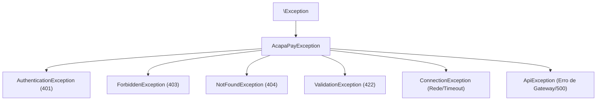

# AcapaPay Laravel SDK — Tratamento de Erros e Resiliência

* **Versão:** `v1.5.0`
* **Data da Documentação:** 08 de Novembro de 2026

---

## 1. Hierarquia de Exceções

Todas as exceções do SDK herdam de `AcapaPay\Laravel\Exceptions\AcapaPayException`, facilitando a captura global ou granular:



---

## 2. Padrão Recomendado de Try / Catch

```php
use AcapaPay\Laravel\Facades\AcapaPay;
use AcapaPay\Laravel\Exceptions\ValidationException;
use AcapaPay\Laravel\Exceptions\ForbiddenException;
use AcapaPay\Laravel\Exceptions\ConnectionException;
use AcapaPay\Laravel\Exceptions\ApiException;

try {
    $result = AcapaPay::refund($invoiceId, $amount, $reason);

} catch (ValidationException $e) {
    // Parâmetros inválidos (ex: montante superior ao valor da fatura, moeda inválida)
    $errors = $e->getErrors();
    return back()->withErrors($errors);

} catch (ForbiddenException $e) {
    // Ação proibida (ex: chamar simulate() fora do modo sandbox)
    return response()->json(['error' => $e->getMessage()], 403);

} catch (ConnectionException $e) {
    // Falha de conectividade (timeout de rede ou DNS)
    Log::error("AcapaPay indisponível: " . $e->getMessage());
    return back()->with('error', 'O serviço de pagamentos está momentaneamente inacessível. Tente novamente em instantes.');

} catch (ApiException $e) {
    // Erros do gateway (ex: saldo insuficiente no TPA, transação não encontrada)
    Log::error("Erro na API AcapaPay [HTTP {$e->getStatusCode()}]: " . $e->getMessage());
    return back()->with('error', $e->getMessage());
}
```

---

## 3. Resiliência e Idempotência

1. **Reconciliação e Idempotência:** Os webhooks podem ser retransmitidos pelo servidor em caso de falha de rede temporária da sua app. Os seus event listeners devem ser idempotentes (por exemplo, verificar se a encomenda já se encontra com status `paid` antes de atribuir créditos).
2. **Rate Limit de Polling:** Se estiver a utilizar polling no front-end para acompanhar uma fatura, mantenha intervalos de consulta de no mínimo 5 segundos. O backend do AcapaPay responde com cache inteligente de 15 segundos para proteger as quotas da AppyPay.
